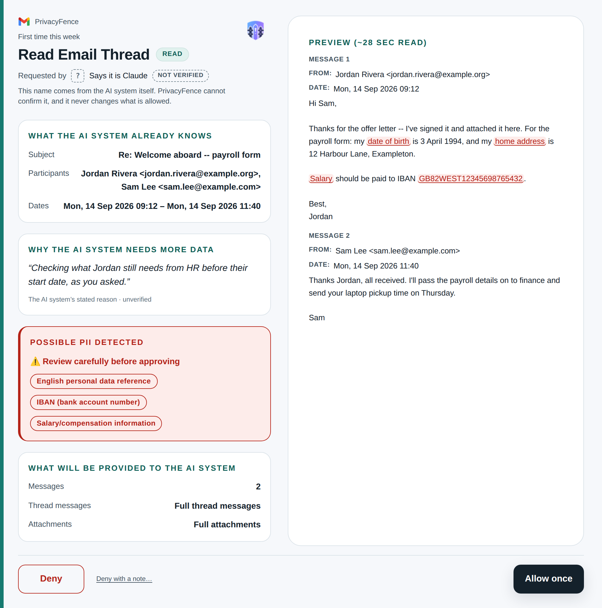

# PrivacyFence

**AI access without giving AI the keys.** Approve the sensitive. Automate the routine.

PrivacyFence is an open-source privacy and approval gateway between AI assistants and your business systems. It connects MCP-compatible assistants such as Claude Desktop and Claude Code to Gmail, Google Drive, Calendar, Slack, Salesforce, Jira, Confluence, Telegram, and more.

PrivacyFence enforces, independently of the AI, what an assistant may see and do. Sensitive reads and consequential actions require human approval, while routine requests can be automated by policy. Optional PII detection runs locally before personal data reaches the AI, and every decision is audited.

PrivacyFence runs as an organization server, delivered as a Docker image, on infrastructure the organization controls, allowing web clients such as claude.ai to connect as well. Connector credentials stay with PrivacyFence, never with the AI client, and no data passes through a PrivacyFence-operated server. When an organization server uses PrivacyFence’s built-in sign-in apps, only the sign-in redirect passes through the PrivacyFence relay, and an organization can use its own apps instead.

**Website:** [privacyfence.eu](https://privacyfence.eu/) · **Install:** [privacyfence.eu/install](https://privacyfence.eu/install/) · **Docs:** [privacyfence.eu/docs](https://privacyfence.eu/docs/)

## Why

Giving an AI assistant access to Gmail, Drive, Slack or Salesforce usually means giving it a
standing permission and trusting it to use that permission well. Being allowed to read a record is
not the same as wanting it sent to an AI, and a tool name in a client's prompt says little about
what is about to change. PrivacyFence puts an independent control point between the assistant and
your systems: the AI asks, PrivacyFence decides, and you see what is at stake before it happens.

## What it does

- **Human approval** for sensitive reads and for writes, on cards that show the actual content or
  change, who is asking and why — not a raw tool name or JSON payload.
- **Local PII detection** before a read reaches the AI: likely personal data is highlighted, and it
  sends the request to a card even when a rule would have let it through.
- **Policy-based automation**: narrow always-allow rules (a sender domain, a Drive folder, a Slack
  channel, a Jira project) let routine requests run without a card.
- **An audit log** of every accepted, denied and automatically approved request, chained so that
  an edit made without its key is detected.
- **Credentials stay with PrivacyFence.** The server runs in its own container, and an
  approval needs your passkey, which the AI client does not hold, so the client cannot approve its own request.
- **A defined set of connectors**, each tool with a gate fixed in code. PrivacyFence is not a
  generic proxy for arbitrary MCP tools.

## How it works

Every client connects to the server's `/mcp` endpoint as a custom connector and signs in with OAuth:
through the organization's identity provider on an organization deployment, or with your passkey on a
single-user install. Clients such as claude.ai, ChatGPT (Developer Mode) and Gemini Enterprise need
an organization deployment on a public HTTPS address. [How it works](https://privacyfence.eu/how-it-works/) walks one read and one
write through, card by card.

## Platforms

| Install | Runs on |
|---|---|
| Organization deployment, or single-user mode on one computer | Docker Engine 24 or newer with the Compose plugin 2.24 or newer (the image is `linux/amd64` and `linux/arm64`) |

Tested with Claude Desktop and Claude Code, and with claude.ai, ChatGPT (Developer Mode) and Gemini
Enterprise through an organization deployment; any MCP-compatible client can connect.

## Connectors

| Connector | What an AI client can do through it |
|---|---|
| Gmail | Search and read messages, threads and attachments; create drafts and replies, labels, filters; archive. No tool sends email. |
| Google Drive, Docs & Sheets | Search, read, download, upload, move and write files; edit and format Docs; read, write and format Sheets |
| Google Calendar | Read events, free/busy and rooms; create, update and delete events; out-of-office and working location |
| Google Contacts, Tasks | Read, create and update contacts and tasks |
| Google Apps Script | Read and write project source; read the result of a run you started (PrivacyFence never runs scripts) |
| Slack | List and read channels, DMs and threads; search; send messages; start group chats |
| Telegram | Read and search chats; send messages |
| Salesforce | Read records, search, run reports; create and update records |
| Jira | Read, create, update, comment on and transition issues |
| Confluence | Search and read pages and attachments; create and update pages |
| Jira Assets | Browse schemas, object types and attributes; search and read objects, linked objects and connected tickets; export to CSV/JSON (read-only) |
| Grist | List documents and tables; read records after review; add and update records, add tables and columns (nothing is deleted) |
| Peek | List your shared HTML pages and their versions; read comments, visit counts and who has access after review; publish pages and new versions, choose who can open them, rename, comment on and delete them |
| Miro | List boards and tags; read items and connector lines after review; add and change sticky notes, cards, texts, shapes, frames and connector lines with approval (nothing is deleted) |

[Connectors](https://privacyfence.eu/connectors/) summarizes what each one reviews and which writes
need approval; the [Tools reference](https://privacyfence.eu/docs/tools-reference/) lists every
tool and its gate.

## Quick start

1. Run the Docker image ([Organization deployment with Docker](https://privacyfence.eu/docs/org-mode-docker/)): `docker run` on your own computer for one person, or the Compose file for a server.
2. Open `http://localhost:8765`, enter the setup code from the container's log, and add a passkey.
3. Connect your services at `/connect`.
4. Add `http://localhost:8765/mcp` to Claude Desktop or Claude Code as a connector, and sign in.
5. Ask your assistant for something, and approve it on the card.

Step by step: [Getting started](https://privacyfence.eu/docs/getting-started/). For claude.ai, ChatGPT or a whole team, see
[Organization deployment](https://privacyfence.eu/docs/org-mode-setup-guide/).

## Documentation

- [Getting started](https://privacyfence.eu/docs/getting-started/) and [Connecting a service](https://privacyfence.eu/docs/connecting-a-service/)
- [Approvals and policy](https://privacyfence.eu/docs/approvals-and-policy/): cards, the PII check, always-allow rules, the privacy filter
- [How it works](https://privacyfence.eu/docs/how-it-works/): the daemon, the MCP endpoint, PrivacyFence's own tools, unattended sessions
- [Configuration reference](https://privacyfence.eu/docs/configuration-reference/): every `settings.yaml` and organization-bundle key
- [Organization deployment](https://privacyfence.eu/docs/org-mode-setup-guide/): running PrivacyFence centrally
- [Security and compliance](https://privacyfence.eu/docs/security-and-compliance/): trust boundary, audit log
- All published docs: [privacyfence.eu/docs](https://privacyfence.eu/docs/). Contributing: [CONTRIBUTING.md](https://github.com/privacyfence/privacyfence/blob/main/CONTRIBUTING.md). Changes per release: [CHANGELOG.md](https://github.com/privacyfence/privacyfence/blob/main/CHANGELOG.md).

## Limitations

PrivacyFence is independent open-source software, not a certified compliance product. It has no
certification, business-continuity plan or SLA, and does not by itself make a deployment compliant
with any regulation. It does not protect against root or a local Administrator, or against anyone who can run `docker` on a single-user install's computer. A name an
AI client gives is a claim, not verified. The full list is
[What PrivacyFence does not claim](https://privacyfence.eu/docs/security-and-compliance/#what-privacyfence-does-not-claim).
To report a vulnerability, see [SECURITY.md](https://github.com/privacyfence/privacyfence/blob/main/SECURITY.md).

## License

Apache License 2.0. See [LICENSE](https://github.com/privacyfence/privacyfence/blob/main/LICENSE) and [NOTICE](https://github.com/privacyfence/privacyfence/blob/main/NOTICE).
